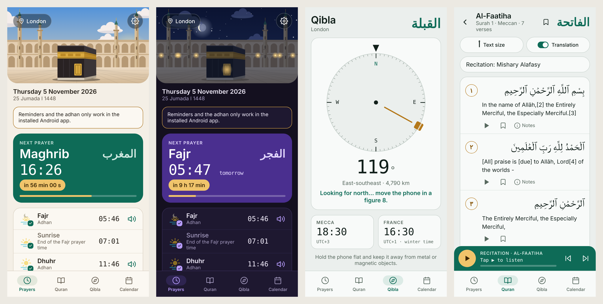
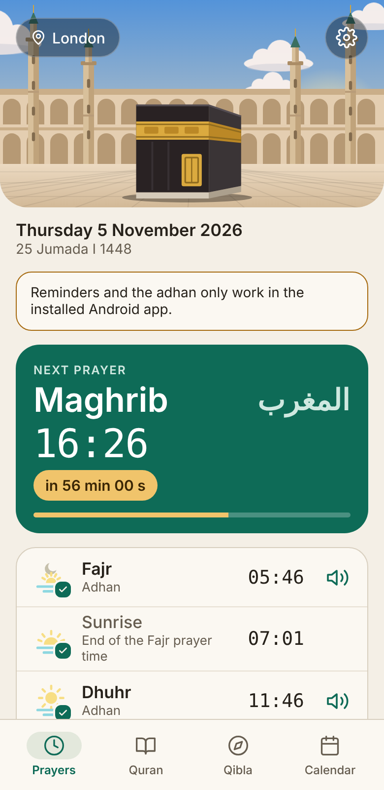
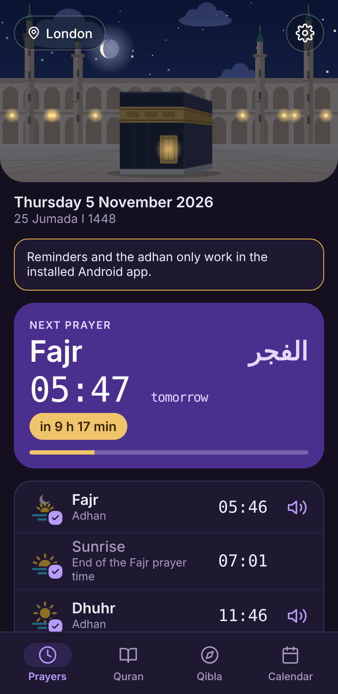
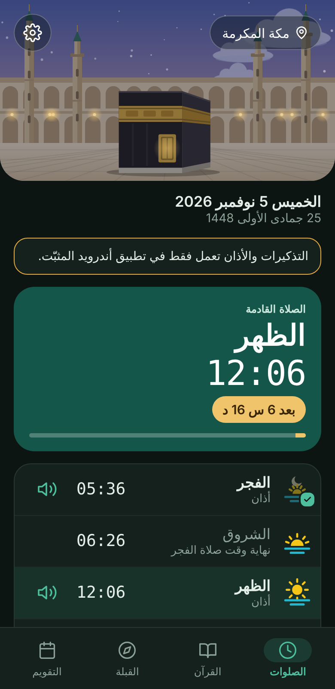
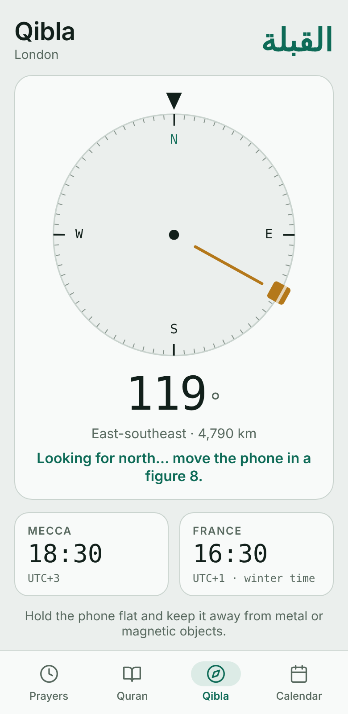
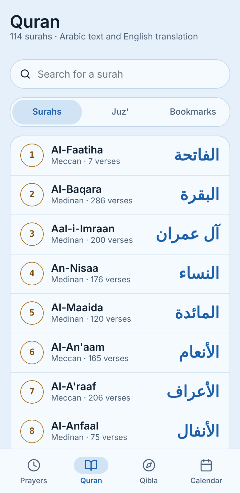
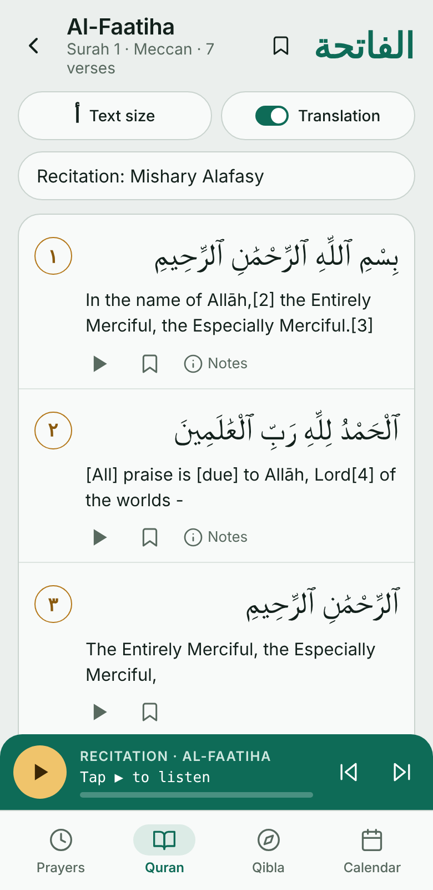
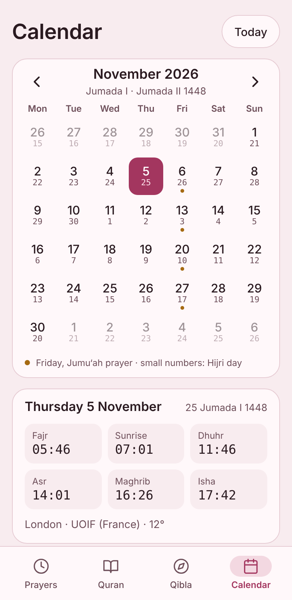
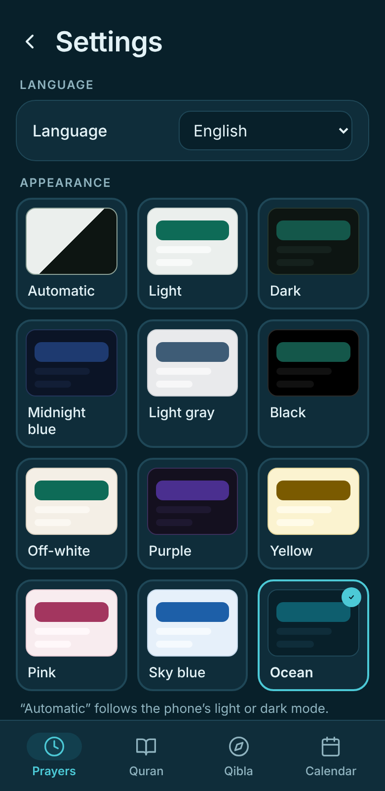
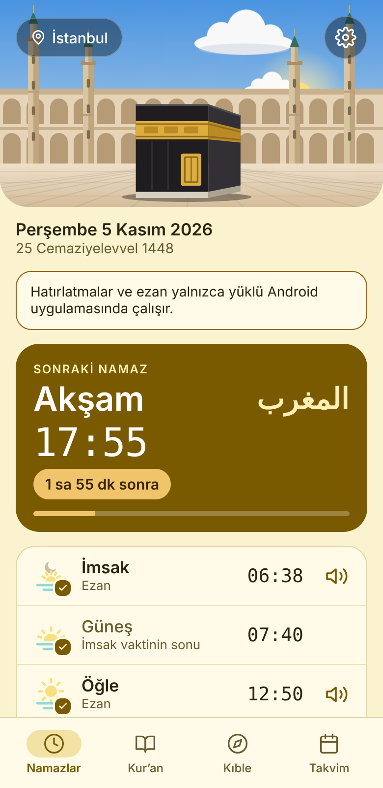

# Salah Compass

**Qibla compass, prayer times with adhan, Quran and Hijri calendar — in one free Android app. No ads, no account, no tracking.**

🌐 English · Français · العربية · Español · Deutsch · Türkçe · Bahasa Indonesia · اردو &nbsp;|&nbsp; 🇫🇷 [Version française plus bas](#français)

  

## Download

Get the latest APK from the **[Releases page](../../releases/latest)** (file `boussole-qibla.apk`), then open it on your Android phone (Android 8.0 or newer). You may need to allow installation from your browser the first time. Installing a new version over an old one keeps your settings.

## Features

### 🕌 Prayer times
- Daily times for Fajr, Sunrise, Dhuhr, Asr, Maghrib and Isha, computed **on your phone** from your location (no server).
- Six calculation methods (UOIF France, Muslim World League, ISNA, Egypt, Umm al-Qura, Diyanet) and Standard / Hanafi Asr.
- **Per-prayer choice**: adhan, silent notification, or off. Optional early reminder (5 to 30 minutes before).
- Live countdown to the next prayer, with a progress bar.
- Adhan plays even with the screen off. **Swipe the notification away or tap it to stop the adhan** (or use the Stop button). Volume and vibration settings.
- Animated **Kaaba courtyard** that follows the real time and your location: sun, moon phase, clouds, stars and lamps.
- Alarms survive a phone restart.

  
  
  

### 🧭 Qibla compass
- Uses the phone's sensors, corrected for magnetic declination, with the exact great-circle bearing to the Kaaba and the distance.
- Tells you when you are facing the Qibla.
- Side-by-side clocks: **Mecca** and your own time zone.

### 📖 Quran
- All 114 surahs in the Arabic text, with a **translation** shown verse by verse (with footnotes you can open and close): **English** when the app is in English, **French** otherwise (French and Arabic interface).
- Search by surah name or number, browse by Juz’, resume where you stopped.
- **Bookmarks** for surahs and individual verses.
- **Verse-by-verse recitation** (several reciters), with a mini player; it continues automatically to the next verse.
- Adjustable text size.

  
  

### 📅 Hijri calendar
- Month view with the Hijri day under every date, Fridays marked, and the prayer times of any selected day.
- Hijri date adjustment (−1 / 0 / +1) to match your local moon sighting.

### 🎨 Languages and themes
- **8 languages:** English, Français, العربية, Español, Deutsch, Türkçe, Bahasa Indonesia, اردو — Arabic and Urdu use a full right-to-left layout. Prayer names, dates and the Hijri calendar follow the chosen language.
- **12 themes**, all checked for readable contrast: Automatic (follows the phone), Light, Dark, Midnight blue, Light gray, Black, Off-white, Purple, Yellow, Pink, Sky blue, Ocean.

  
  

## Privacy

No ads, no account, no analytics. Your settings and your location stay on your phone. The only network use is the optional Quran recitation, which streams audio from [everyayah.com](https://everyayah.com).

## Good to know

- Calculated prayer times can differ by a few minutes from your local mosque. When in doubt, follow your mosque.
- Quran translations: French (French and Arabic interface) and English (all other languages) for now.
- Reminders and the adhan need the notification permission (and exact alarms) on Android.

## Sources and licences

- **Arabic Quran text:** [Tanzil Project](https://tanzil.net) — CC BY 3.0, text unmodified.
- **French translation:** Dr Nabil Rudwan, Noor International Center (v1.0.0), via [QuranEnc.com](https://quranenc.com) — text displayed unmodified.
- **English translation:** Noor International Center (v1.1.2), via [QuranEnc.com](https://quranenc.com) — text displayed unmodified.
- **Recitations:** streamed from [everyayah.com](https://everyayah.com), not stored in the app. Rights belong to the reciters.
- **Quran data format:** [risan/quran-json](https://github.com/risan/quran-json) (CC BY-SA 4.0).
- The Kaaba illustration and the app icon are original drawings made for this project.

## Build

The APK is built automatically by GitHub Actions on every push to `main` and attached to a release (`apk-<number>`).
The app is a native Android shell (`app/src/main/java`) around a local web interface (`app/src/main/assets`: `index.html`, `core.js`, `prayers.js`, `qibla.js`, `quran.js`, `scene.js`, `i18n.js`). Native code handles exact alarms, the adhan service, notifications and the compass sensor.

To build locally: `./gradlew assembleDebug` (JDK 17 and the Android SDK are required). To preview the interface in a browser, serve `app/src/main/assets` with any static web server.

---

## Français

**Salah Compass** : boussole de la Qibla, horaires de prière avec adhan, Coran et calendrier hégirien dans une seule application Android gratuite, sans publicité, sans compte et sans suivi.

**Télécharger :** [dernière version (APK)](../../releases/latest), fichier `boussole-qibla.apk`.

**Fonctionnalités**
- **Prières** : horaires calculés sur le téléphone, six méthodes (dont UOIF), Asr standard ou hanafite ; au choix pour chaque prière : adhan, notification ou désactivé ; rappel avant la prière ; compte à rebours ; l'adhan s'arrête en touchant ou en balayant la notification ; scène animée de la Kaaba qui suit l'heure et le lieu.
- **Qibla** : boussole avec capteurs du téléphone, angle exact et distance, heures de La Mecque et de France.
- **Coran** : 114 sourates en arabe avec traduction française (anglaise pour les langues autres que le français et l'arabe) verset par verset et notes, recherche, Juz’, marque-pages, récitation verset par verset.
- **Calendrier hégirien** avec ajustement de la date et horaires du jour sélectionné.
- **8 langues** : français, anglais, arabe, espagnol, allemand, turc, indonésien, ourdou (arabe et ourdou de droite à gauche) ; **12 thèmes** lisibles.

**Confidentialité** : aucune donnée collectée ; réglages et position restent sur le téléphone. Seule la récitation du Coran utilise Internet.

**Sources et licences** : texte arabe [Tanzil](https://tanzil.net) (CC BY 3.0) ; traduction du Dr Nabil Rudwan, Noor International Center, via [QuranEnc.com](https://quranenc.com) ; récitations [everyayah.com](https://everyayah.com).

Les horaires calculés peuvent différer de quelques minutes de ceux de votre mosquée : en cas de doute, suivez votre mosquée.
